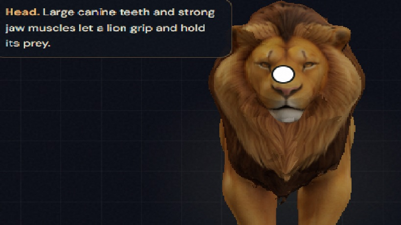

# Wildlife Anatomy Museum

Explore nine animals and the human body in interactive 3D. Rotate each specimen, switch on the labels, and tap the dots to learn what every body part does.

**Live demo:** https://wildlife-anatomy-museum.netlify.app

## Features

- Ten 3D specimens: lion, elephant, giraffe, kangaroo, tiger, wolf, chimpanzee, hippopotamus, crocodile and human
- Clickable dots on each model that explain a body part
- Labels button that shows or hides the dots
- Search and habitat filter for the collection
- Species profile with Overview, Adaptations and Facts tabs
- Model credit shown with every specimen
- First-visit guide and a "How it works" button
- Text size controls (A−, A+ and reset) that remember your choice
- Works on laptop and phone, with drag to rotate and pinch to zoom

## Built with

- React and TypeScript
- Vite
- Tailwind CSS
- Three.js with React Three Fiber and Drei
- Font Awesome (installed offline from npm)
- Deployed on Netlify

## Run it locally

    npm install
    npm run dev

Then open http://localhost:5173

To make a production build:

    npm run build

## 3D model credits

The 3D models are third-party work shared under Creative Commons licences. Credit is also shown in the app next to each specimen.

- Lion: "Realistic_Lion 3D_model_of_texture_fbx" by mohamed.salaah880, licensed under CC BY 4.0. Converted and resized for web display.
- Elephant: "Elephant" by Stephengury, licensed under CC BY 4.0. Converted and resized for web display.
- Giraffe: Giraffe_Textured" by davidgrima, licensed under CC BY 4.0. Converted and resized for web display.
- Kangaroo: "Kangaroo" by rinaskylark, licensed under CC BY 4.0. Converted and resized for web display.
- Tiger: "Tiger" by Vavtrudner, licensed under CC BY 4.0. Converted and resized for web display.
- Wolf: "Wolf" by AX-7YK, licensed under CC BY 4.0. Converted and resized for web display.
- Monkey: "chimpanzee Monkey 3d model free" by iRahulRajput, licensed under CC BY 4.0. Converted and resized for web display.
- Hippopotamus: "Hippopotamus" by SDPM Esare, licensed under CC BY 4.0. Converted and resized for web display.
- Crocodile: "Crocodile 3d model free" by iRahulRajput, licensed under CC BY 4.0. Converted and resized for web display.
- Human: "Perfect Human Body" by CAPTAAINRO, licensed under CC BY 4.0. Converted and resized for web display.

## Author

Olamide Akinola

- GitHub: https://github.com/OMOAKIN1-devburn
- LinkedIn: https://linkedin.com/in/omoakin1
- Portfolio: https://omoakin1-devburn.github.io/portfolio-website/
  Fill in the credits list from your Credits.tsx file. Model licences require that attribution.
